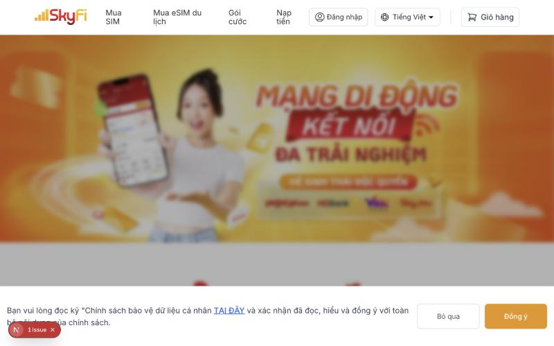
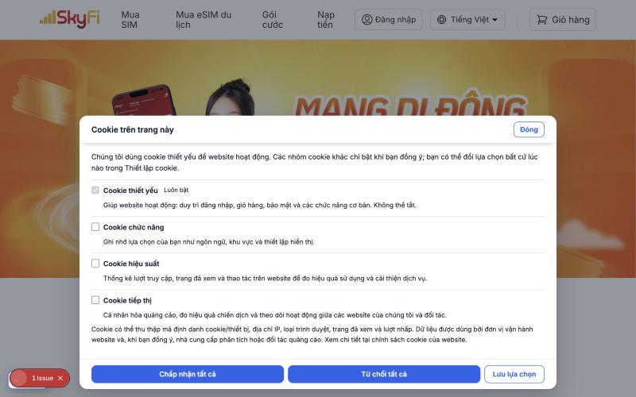
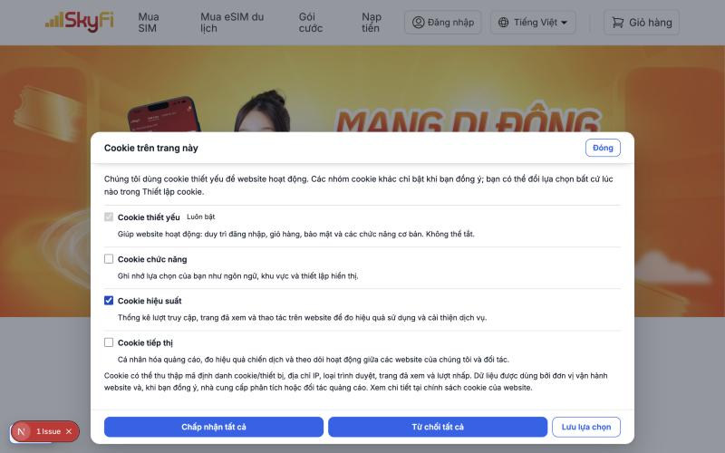

# Kết quả kiểm thử CMP cookie

## Video

[▶ Xem video kết quả](https://jam.dev/s/f48e4b15-b0b1-479d-81e6-68b623f24799)

Video quay vùng trình duyệt trên máy dev (55 giây), gồm 4 bước:

1. CMP bật: popup cookie cũ của SkyFi đã ẩn, GA4 đóng băng, chưa nạp script GA nào.
2. Banner 4 nhóm cookie (bản xem trước bằng SDK thật), tick "Cookie hiệu suất" = `COOKIE_ANALYTICS`.
3. Trang `/vi/travelsim?type=freemium` trước khi đồng ý: chưa có script GA nào.
4. Giả lập khách đồng ý: `G-JWM8CQNVB2` được nạp, `dataLayer` xuất hiện.

Thanh đen ở đầu trang trong video là chú thích chèn bằng script, không phải giao diện của web.
Banner ở bước 2 chưa nối CMP thật, và việc "đồng ý" ở bước 4 là phát sự kiện giả lập.

## Ảnh chụp

**Ảnh 1: CMP tắt (như hiện tại).** Web chạy như trước khi tích hợp. Thanh cuối trang "Bỏ qua / Đồng ý" là popup chính sách cũ của SkyFi, GA4 nạp bình thường.

**Ảnh 2: CMP bật, SDK của CMP thật chưa nạp được.** Popup cũ đã ẩn, GA4 vẫn đóng băng (`text/plain`, chưa nạp script GA). Banner CMP chưa hiện vì server CMP thiếu CORS (`CMP_SDK_LOAD_FAILED`). Đây là hành vi fail-closed: SDK lỗi thì không tracking.

**Ảnh 3: banner 4 nhóm cookie.** Hiển thị bằng hàm `preview` của SDK 1.10.0 thật, tương ứng 4 mã `COOKIE_NECESSARY` (luôn bật), `COOKIE_FUNCTIONAL`, `COOKIE_ANALYTICS`, `COOKIE_MARKETING`. Chưa nối CMP thật nên nút bấm chỉ chạy thử, chữ chính thức do pháp chế soạn trên CMS.

**Ảnh 4: tick "Cookie hiệu suất".** Nhóm này là `COOKIE_ANALYTICS`, mã điều khiển việc nạp GA4. Chỉ `COOKIE_ANALYTICS` và `COOKIE_MARKETING` đang chặn tag của SkyFi.
